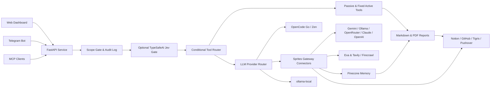

# CYBOT

[](https://www.python.org/downloads/)
[](https://fastapi.tiangolo.com/)
[](https://sprites.dev/)
[](LICENSE)

**CYBOT** is a scope-gated bug bounty reconnaissance agent that runs on [Fly.io Sprites](https://sprites.dev/). It verifies explicit target authorization before sending any packet, enforces strict passive/light/standard intensity boundaries, uses Sprites gateway connectors so upstream API keys stay off the runtime machine, and produces plain-language Markdown, PDF, and optional Notion reports.

**Live instance:** [https://cybot-b6uzb.sprites.app](https://cybot-b6uzb.sprites.app)

---

## Features

- **Deterministic Scope Gate:** Refuses out-of-scope domains, excluded subdomains, CIDR ranges, and non-public IPs (loopback, private, link-local, metadata) before any tool executes. Logs every decision with a SHA-256 scope digest and authorization statement.
- **Tiered Recon Pipeline:**
  - **Passive:** Public resolvers (Cloudflare DoH), certificate transparency logs (`crt.sh`), RDAP, optional `subfinder`, and optional OSINT/code-path lookups. Sends zero packets to the target.
  - **Light / Standard (explicit approval required):** Adds a single homepage fetch, technology header fingerprinting, fixed web-port TCP checks (`80`, `443`, `8080`, `8443`, plus two extra in standard), fixed public-path checks, optional `httpx`, and NVD 2.0 version correlation (always labeled unverified).
- **Multi-Provider LLM Routing:** Supports **OpenCode** (Go & Zen), **Sprites Connectors** (Gemini, Ollama Cloud, OpenRouter/Grok, Anthropic, OpenAI), local CPU inference (`ollama-local`), encrypted vault fallback keys, and an offline `MockLLM`.
- **Sprites Gateway Integrations:**
  - **Active on the live deployment:** **Gemini** (planning, triage, plain-English explanations), **Firecrawl** (single-page homepage rendering), **Notion** (opt-in report pages, findings tracker, scope loading), and **Pinecone** (per-program semantic memory & deduplication).
  - **Supported when wired:** **Exa** (neural asset discovery & `/contents`), **Tavily** (factual CVE & advisory search), **TypeSafeAI Jev** (stricter scope, active-check, and false-positive decision gate), **Ollama Cloud**, **OpenRouter**, **Anthropic**, **OpenAI**, **GitHub**, **Tigris / S3**, **Pushover**, **Linkup**, and **Kagi**.
- **Three Interfaces:**
  1. **Web Dashboard** - Responsive SPA for mission setup, live SSE event logs, findings review, Markdown/PDF export, Notion opt-in, and Settings/Vault management.
  2. **MCP Server** - JSON-RPC (`2024-11-05`) over `POST /api/mcp` (bearer-authenticated) and stdio (`python -m cybot mcp`).
  3. **Telegram Bot** - Long-polling interface for passive recon against the saved dashboard scope (`/recon`, `/status`, `/findings`, `/report`) and inline Notion confirmation prompts.
- **External MCP Policy Filter:** Allows attaching read-oriented external MCP servers from Settings while blocking exploit, fuzzing, credential-attack, and intrusive scanner tools via a strict allowlist + denylist.
- **Research playbooks:** For each target and finding, CYBOT writes unverified manual next steps (safe `curl`, `httpx`, `nuclei` template ids, and a scoped `ffuf` suggestion) plus deterministic reference links (NVD, CVE.org, GitHub Advisory search, Exploit-DB search, CWE, OWASP WSTG, PortSwigger, and HackTricks). CISA KEV and FIRST EPSS are added when those services answer. Exa or Tavily can add writeups when a connector is granted. The model writes the narrative; a fixed template is used if it fails. CYBOT never runs exploits.
- **Finding assistant:** On each finding, Ask CYBOT answers Explain, Impact, Retest steps, Fix / remediation, Related research, or a free-text question. Context is the saved note, playbook, and knowledge-base hits. The configured model is used when it answers; otherwise a playbook template is saved. The thread is stored per finding. Answers are manual validation guidance for the in-scope asset. They do not include exploit code, WAF bypasses, or out-of-scope origins. The same action is the MCP tool `finding_assist`.
- **Submission cards:** Each finding is a draft report card (title, severity, asset, CWE, summary, numbered steps, redacted evidence, impact, fix, references, and validation status). Copy as Markdown copies one card. Export report downloads the run. Notion report pages include the redacted summary and repro when those blocks fit.

---

## Architecture



---

## Tech Stack

| Layer | Technology |
| --- | --- |
| **Runtime** | Fly.io Sprites (isolated persistent Linux VM) |
| **Backend** | Python 3.11+, FastAPI, Uvicorn, Pydantic v2, httpx |
| **Storage & Crypto** | SQLite (`cybot.db`), `cryptography` (Fernet vault + `scrypt` password hashing) |
| **Reports** | Markdown + `fpdf2` PDF generation + optional Notion API (`2026-03-11`) |
| **Frontend** | Vanilla HTML/CSS/ES Modules SPA (`src/cybot/web/static/`) |
| **Agent Protocol** | Model Context Protocol (`2024-11-05`) over HTTP & stdio |

---

## Sprites Connectors & Policies

CYBOT discovers granted connectors at runtime from inside a Sprite via `GET https://api.sprites.dev/v1/gateway/list` and routes requests through:

```
https://api.sprites.dev/v1/gateway/<provider>/<connection_id>/<path>
```

API keys live in the Fly.io control plane - not on the Sprite - and the gateway injects credentials per request. Every connector in Fly.io **must have an access policy** allowing the target Sprite (for example, name prefix `cybot`); connectors without a policy deny all Sprites with `403`.

### Connector Matrix

| Connector | Purpose | Gateway Routes Allowed by CYBOT | Live Status |
| --- | --- | --- | --- |
| **Gemini** | Default LLM for tool planning, finding triage, and plain-English explanations (`gemini-flash-lite-latest`) | `POST /v1beta/models/<model>:generateContent` | Wired & Active |
| **Firecrawl** | Single-URL homepage rendering for JS-heavy in-scope targets | `POST /v2/scrape` | Wired & Active |
| **Notion** | Opt-in scan report pages, findings tracker (`new`, `triaged`, `reported`, `duplicate`, `fixed`), and optional scope source (`Notion-Version: 2026-03-11`) | `GET /v1/users/me`, `GET /v1/databases/{id}`, `GET /v1/data_sources/{id}`, `POST /v1/data_sources/{id}/query`, `POST /v1/pages` | Wired (configure DB IDs in Settings) |
| **Pinecone** | Per-program vector memory (`X-Pinecone-Api-Version: 2026-07`); marks findings with similarity `>= 0.92` as `Seen before` | `GET /indexes`, `POST /embed`, `POST /indexes/{index}/query`, `POST /indexes/{index}/vectors/upsert` | Wired (create an index in Pinecone) |
| **Exa** | Neural discovery of related public assets and single-page `/contents` (falls back to Tavily) | `POST /search`, `POST /contents` | Supported |
| **Tavily** | Factual CVE, advisory, and short-answer search (falls back to Exa) | `POST /search` | Supported |
| **TypeSafeAI (Jev)** | Stricter probabilistic gate on scope wording, active-check approval, false positives, and severity | `GET /v1/models`, `POST /v1/systemone` | Supported |
| **Ollama Cloud** | Cloud LLM inference via Sprites connector | `POST /v1/chat/completions`, `POST /api/chat` | Supported (unused for now) |
| **OpenRouter** | Multi-model routing including xAI Grok (`x-ai/*` model IDs) | `POST /api/v1/chat/completions` | Supported |
| **Anthropic / OpenAI** | Alternative chat models (and OpenAI embeddings fallback for Pinecone) | `POST /v1/messages`, `POST /v1/chat/completions`, `POST /v1/embeddings` | Supported |
| **GitHub** | Public code-path discovery for a named org (`paths` only, no file contents) and optional report export | `GET /search/code`, `PUT /repos/{owner}/{repo}/contents/cybot-reports/{id}.md` | Supported |
| **Tigris / S3** | Secondary Markdown report storage | `PUT /cybot/reports/{id}.md` | Supported |
| **Pushover** | Optional run-completion push alerts | `POST /1/messages.json` | Supported |

### Setting Up Connectors

1. In the Fly.io dashboard, open your organization → **Sprites** → **Connectors** → **Add connector**.
2. Choose a provider, enter its API key or complete OAuth, and save.
3. Open the connector's **Access** tab and add a policy allowing your Sprite (e.g., `name_prefix: cybot`).
4. In CYBOT **Settings**, refresh the connector list, pick your model provider (or `auto`), and configure optional connector settings (Notion database IDs, Pinecone index name, Jev model ID).

### Notion Databases (Opt-In)

Notion publishing defaults to `ask` (`yes`, `no`, or `ask`). Share your databases with the Notion integration and configure their 32-character IDs in Settings:

- **Recon reports:** Title, `Program`, `Scope`, `Intensity`, `Run`, `Started` (date), `High`, `Medium`, `Low`, `Info` (numbers).
- **Findings tracker:** Title, `Status` (`new`, `triaged`, `reported`, `duplicate`, `fixed`), `Severity` (`info`, `low`, `medium`, `high`), `Program`, `Host`, `Tool`, `Finding ID`, `Created` (date).
- **Programs & Scope:** Title, `Include`, `Exclude`, `Authorization`, `Active` (checkbox).

---

## LLM Providers

- **OpenCode (Primary Configuration Default):** Supports OpenCode **Go** (`https://opencode.ai/zen/go/v1`) and **Zen** (`https://opencode.ai/zen/v1`) using `OPENCODE_API_KEY` (or the `opencode` vault secret) with default model `deepseek-v4.1-flash`.
- **Gemini Connector (Active on Live Sprite):** Uses the Sprites `gemini` connector (`connector:gemini:<id>`) with `gemini-flash-lite-latest` as the default model.
- **Ollama Cloud & Local:** Ollama Cloud works via the Sprites `ollama` connector (supported, currently unused). For offline CPU testing inside a Sprite, `scripts/install-ollama-local.sh` installs Ollama on `127.0.0.1:11434` and pulls `qwen2.5:1.5b` or `qwen2.5:3b`.
- **Auto Provider Order:** Setting `provider` to `auto` walks `CYBOT_PROVIDER_ORDER` (default `opencode,ollama,openrouter,anthropic,openai,gemini`) and selects the first configured provider, falling back to `MockLLM`.

---

## Quick Start & Deploy

### Local Development

```sh
python3 -m venv .venv
. .venv/bin/activate
pip install -e ".[dev]"
pytest
CYBOT_DEMO=1 python -m cybot serve --host 0.0.0.0 --port 8641
```

Open [http://127.0.0.1:8641](http://127.0.0.1:8641) and set a dashboard password (minimum 10 characters) on first visit. `CYBOT_DEMO=1` enables the safe `example.com` fixture option without contacting external hosts.

### Deploy on a Fly.io Sprite

Inside a Sprite (with the repository at `/home/sprite/cybot`):

```sh
sh scripts/sprite-bootstrap.sh
```

`sprite-bootstrap.sh` creates `.venv`, installs CYBOT, creates `CYBOT_DATA_DIR` (`$HOME/cybot-data`, mode `0700`), and registers/restarts the persistent `cybot` Sprite service on port `8641` (pass `CYBOT_WITH_OLLAMA=1` to also install `ollama-local`). Set the Sprite URL visibility to **Public** if accessing the dashboard externally; CYBOT enforces its own first-visit password and session auth.

---

## Configuration & Environment

| Variable | Default | Purpose |
| --- | --- | --- |
| `CYBOT_DATA_DIR` | `./data` | Directory for `cybot.db` and `master.key` (mode `0600`) |
| `CYBOT_HOST` / `CYBOT_PORT` | `0.0.0.0` / `8641` | HTTP bind host and port |
| `CYBOT_DEMO` | `0` | Set `1` to allow the reserved `example.com` demo fixture |
| `CYBOT_PROVIDER` | _(saved setting: `opencode`)_ | Overrides the saved LLM provider (`opencode`, `auto`, `sprites`, `connector:<name>:<id>`, `ollama-local`, `mock`, `direct-*`) |
| `CYBOT_MODEL` | _(saved setting)_ | Overrides the model ID (`deepseek-v4.1-flash` for OpenCode, `gemini-flash-lite-latest` for Gemini connector) |
| `CYBOT_PROVIDER_ORDER` | `opencode,ollama,openrouter,anthropic,openai,gemini` | Fallback order when `provider=auto` |
| `OPENCODE_API_KEY` | _(unset)_ | OpenCode API key (or store as `opencode` in the vault) |
| `OPENCODE_PRODUCT` | `go` | `go` or `zen` |
| `OPENCODE_BASE_URL` | _(derived)_ | Overrides the OpenCode endpoint |
| `OLLAMA_HOST` | `http://127.0.0.1:11434` | Local Ollama daemon URL for `ollama-local` |
| `SPRITES_GATEWAY_LIST` | `https://api.sprites.dev/v1/gateway/list` | Sprites gateway discovery endpoint |
| `CYBOT_MASTER_KEY` | _(auto-generated)_ | Fernet key for encrypting stored vault secrets |
| `CYBOT_MCP_TOKEN` | _(unset)_ | Required bearer token for `POST /api/mcp` |
| `CYBOT_MCP_STDIO` | `0` | Set `1` to allow attaching stdio external MCP servers |
| `TELEGRAM_BOT_TOKEN` | _(unset)_ | Telegram bot token from `@BotFather` (or vault secret `telegram`) |
| `CYBOT_TELEGRAM` | `1` | Set `0` to disable Telegram long-polling |
| `CYBOT_MAX_HOSTS` | `20` | Maximum in-scope hosts per run |
| `CYBOT_RATE_PER_MIN` | `20` | Per-host outbound HTTP request rate limit |
| `CYBOT_RUN_TIMEOUT` | `120` | Run time budget in seconds |
| `CYBOT_COOKIE_SECURE` | _(auto from `X-Forwarded-Proto`)_ | Force `Secure` cookie flag (`1` or `0`) |

Optional direct secrets stored encrypted in the vault: `opencode`, `ollama`, `openrouter`, `gemini`, `grok`, `anthropic`, `openai`, `shodan`, `virustotal`, `nvd`, `telegram`, `pushover_user`.

---

## MCP & Telegram

### MCP Endpoint

- **HTTP:** `POST /api/mcp` with `Authorization: Bearer <CYBOT_MCP_TOKEN>`
- **Stdio:** `python -m cybot mcp`

Exposed tools: `check_scope`, `start_recon`, `get_status`, `get_findings`, `explain_finding`, `get_playbook`, `get_report`, `list_tools`, `publish_report_to_notion`, `list_tracked_findings`, `list_notion_programs`, `search_memory`.

`get_playbook` returns the research playbook for one finding id: why it matters, manual checks, evidence to capture, and reference links. Optional Notion tracker properties `Next steps`, `References`, `EPSS`, and `KEV` are filled when those columns exist.

`start_recon` accepts `mode` (`passive`, `soft-active`, `active-test`). `authorization` and `attestation` are optional. When they are omitted, CYBOT records a scope-limited statement for the named program. A caller that still sends them is honored. Out-of-scope hosts are refused. Telegram stays on passive runs.

`start_recon` accepts `publish_to_notion` (boolean); omitting it leaves Notion unpublished until `publish_report_to_notion` is called explicitly.

### Telegram

When `TELEGRAM_BOT_TOKEN` (or vault `telegram`) is set, CYBOT long-polls the Telegram Bot API. Telegram is restricted to **passive** runs against the scope saved on the dashboard (`/recon <host>`, `/status`, `/findings`, `/report`) and prompts with inline **Yes / No** buttons before creating a Notion page.

---

## Security & Scope Safety

1. **Scope Enforcement:** Targets must match an `include` rule (`*.domain` matches one subdomain label; `.domain` matches apex and subdomains), not match an `exclude` rule, and resolve exclusively to public IP addresses.
2. **No Exploitation or Fuzzing:** `PUBLIC_PATHS` strictly avoids sensitive files (`.env`, `.git`, admin/backup paths). Optional binaries run with locked argument vectors and no shell. `OWASP ZAP`, `Burp Suite`, Metasploit, and credential tools stay excluded (`src/cybot/catalog.py`). See Scanning modes and safety.
3. **Output & Secret Hygiene:** Secret values are encrypted at rest with Fernet, never returned by the API, and redacted from error messages and explanations. LLM explanations reject code blocks and exploit-like tokens.
4. **Web & API Hardening:** Scrypt-hashed dashboard password, `HttpOnly; SameSite=Strict` cookies, `X-CYBOT: 1` header check on mutating API routes, login rate limiting, and `Content-Security-Policy` headers.

---

## Scanning modes and safety

Every check goes through the same rails before a packet or a binary is used: scope, rate limit, and request budget. Choosing a mode is the opt-in. CYBOT records the authorization statement itself when the caller does not send one. A missing binary is skipped. CYBOT records a confidence score, a curl command a person can retest, and `needs_human_validation`. It does not confirm a vulnerability.

| Mode | What it may do | What it requires |
| --- | --- | --- |
| **passive** | Resolvers, certificate logs, RDAP, and optional `subfinder`, `dnsx`, `dig`, `whois`. No packets to the target. | An in-scope target. Telegram `/recon` and `/scan` stay here. |
| **soft-active** | One homepage fetch, header notes, a fixed web-port connect (`80`, `443`, `8080`, `8443`), and optional `httpx`, `whatweb`, `wafw00f`, `naabu`, `nmap -sT`. | The soft-active mode on an in-scope target. |
| **active-test** | The soft-active set, plus optional `katana`, `nuclei` (info/low exposure tags only), `ffuf` and `gobuster` on a short public-path list, `dalfox` without a blind callback, and `sqlmap` boolean detection only. | An in-scope host, the example.com fixture, or the local demo on `127.0.0.1`. |

Refused in every mode: `sudo`, raw SYN scans, NSE scripts, `sqlmap` dump or shell or file read, and any host outside the include list. Private, loopback, link-local, and metadata addresses are blocked. The only exception is the bundled demo app on `127.0.0.1`, and only when demo mode is on and the run is active-test.

The demo app is `src/cybot/demo_app.py`. It binds to `127.0.0.1` only and includes a reflected query parameter and a boolean SQLite lookup so validation can be practiced on this machine. Load it from the dashboard with **Load local demo**.

Optional tools are installed with `sh scripts/install-scan-tools.sh`. The script prints `ready` or `missing` for each binary and exits 0 even when some are absent. `sh scripts/install-scan-tools.sh --install` tries distro packages for `nmap`, `whatweb`, `wafw00f`, `dnsutils`, and `whois`, then still exits 0 if that fails.

### Terminal

The dashboard Terminal and the MCP tool `run_command` share one runner. The allowlist is `curl`, `httpx`, `gobuster`, `ffuf`, `dig`, `whois`, `nslookup`, `host`, `nmap`, `openssl`, `whatweb`, `wafw00f`, `jq`, `grep`, and `sed`. Every host, URL, and IP in the command is checked against the scope gate. Private and metadata addresses are refused, except the demo app on `127.0.0.1` during an active-test demo run. `sudo`, shell pipes, redirects, and writes outside the run directory are refused. Intrusive flags and `ffuf` / `gobuster` require active-test. Active-test commands still wait for confirmation in the terminal.

Passive and soft-active commands run after the check. Active-test stays in confirm mode until you confirm. Each command has a timeout and an output cap, and it is written to the audit log. A suggest-and-check loop stops after 6 steps.

---

## Knowledge base

CYBOT can cite a vendored catalog while it writes a finding's next steps. The files live in `data/knowledge/` and are copied from [CYBWithFlourish/Awesome-Hacking-with-AI](https://github.com/CYBWithFlourish/Awesome-Hacking-with-AI) (MIT license): `resource-catalog.json` and the guide notes for agentic security, AI security, MCP, models, and evidence. Nothing is fetched at runtime.

`cybot kb ingest` chunks the guides, turns each catalog entry into a document, embeds them with the existing Pinecone path, and upserts them into the `cybot-kb` namespace. That namespace is separate from per-program memory. The command is idempotent: each document has a stable id, and a later ingest overwrites that id instead of inserting a duplicate. `cybot kb search "query"` prints the top titles and catalog URLs. The same actions are available as the MCP tools `kb_ingest` and `kb_search`.

When a playbook is built, CYBOT retrieves the closest catalog entries and lists them under **Further reading / techniques**, separate from the deterministic CVE reference links. A URL is included only when it is the entry's `canonical_url`. The model does not invent knowledge-base links.

You need a granted Pinecone connector and an index (set the index name in Settings) before `cybot kb ingest` can write vectors.

## License

Released under the [MIT License](LICENSE).
